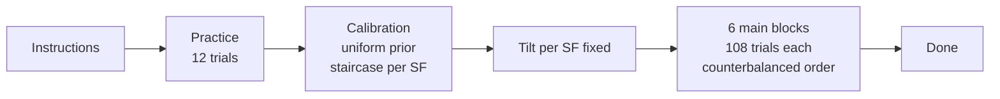
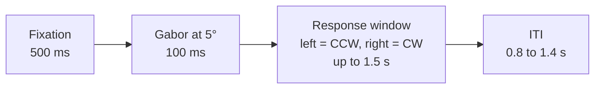
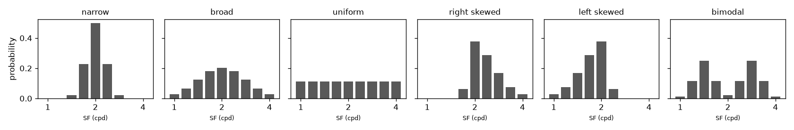
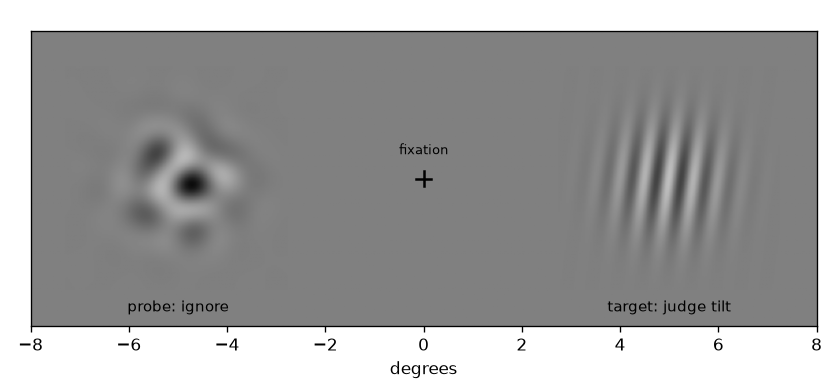
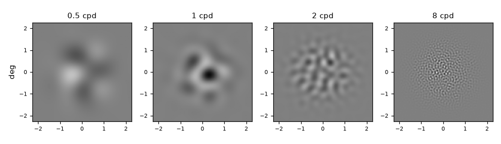

# Spatial frequency uncertainty and visual cortical tuning

When the spatial frequency (SF) of an upcoming stimulus is uncertain, does early visual cortex prepare for a single expected SF or for the whole distribution of likely SFs? This repository contains a PsychoPy experiment I wrote to start testing that question, together with tools for configuring it, analyzing the data, and simulating tuning models.

The current version is a behavioral prototype. It has not been validated on lab hardware or in the scanner. The scientific background, hypotheses and open design decisions are in [docs/PROTOCOL.md](docs/PROTOCOL.md).

## Research questions

Primary

1. With the mean expected SF held constant, does population SF tuning depend only on that mean, or on the full shape of the expected distribution?
2. Does greater uncertainty (a broad vs. a narrow prior with the same mean) broaden pSFT bandwidth? This would be the feature-space analogue of the attentional field broadening with cue width reported by Bloem et al. (2025).
3. Does a skewed prior produce asymmetric tuning, beyond a simple peak shift?
4. Does a bimodal prior produce a flattened or two-peaked population profile, or a single peak between the two expected SFs?

Mechanism

5. Can apparent changes in bandwidth or peak be explained by response gain on channels near the expected SFs, with no change in tuning shape?
6. Are the effects driven by knowing the distribution (expectation) or by exposure to its stimuli (adaptation)?
7. Do the effects hold for task-irrelevant probes presented in the opposite hemifield?

Behavioral (testable with this version)

8. At a fixed SF, are orientation judgments more accurate or faster when that SF is more probable?
9. Do behavioral effects scale with prior variance, with entropy, or with neither?
10. Is a histogram cue enough to establish the prior, or does it need to be learned over the block?

Methods

11. Which comparison is cleaner for distribution shape: matching mean and variance, or matching the mode?
12. How many probe SFs and trials are needed to tell Gaussian, asymmetric and bimodal tuning apart?

Questions 1 to 7 need neural data, such as fMRI pSFT fits with the [pSF-Toolbox](https://github.com/luisdramirez/pSF-Toolbox). Behavior alone cannot answer them.

## The task



Each main block opens with a histogram of the SF probabilities for that block. Each trial:



There is no feedback. The calibration staircases (2-down/1-up, about 71% correct) equate difficulty across SFs before the main blocks, and the tilt stays fixed after that.

The full session is about 930 trials, roughly 40 minutes. Every trial is saved as soon as it ends. Escape stops the session, and `--resume` continues from the next unsaved trial. A resume is refused if the config, the counterbalancing row or the data columns have changed since the session started.

## Conditions

SFs come from a 9-level log2 grid from 1 to 4 cpd, centered on 2 cpd.



Narrow and broad are Gaussians with SDs of 0.2 and 0.46 octaves. Right and left skewed keep their peak at 2 cpd and put more probability above or below it (56% of right-skewed trials are above 2 cpd). Bimodal peaks at 1.41 and 2.83 cpd. This is the default `"matching": "mode_matched"`. With `"moment_matched"`, broad, skewed and bimodal instead share one mean and variance, checked numerically; uniform cannot be matched on a fixed grid and is reported as unmatched.

In the probe version (`"paradigm": "probe"`), half the trials add a task-irrelevant probe in the opposite hemifield, with SFs from 0.5 to 8 cpd. The probe sequence is identical across conditions, so differences in probe responses come from expectation, not from the stimuli.



`"probe_type": "noise"` (the default in `configs/demo_probe.json`) uses band-pass filtered noise, as Ramirez et al. (2025) did to map pSFT; `"gabor"` uses a Gabor. Contrast is `probe_contrast` (default 100%) and the pass band width is `probe_noise_bandwidth_oct`.



## Install

```bash
python3 -m venv .venv && .venv/bin/pip install -r requirements.txt
python3.10 -m venv .venv-psychopy && .venv-psychopy/bin/pip install -r requirements-psychopy.txt
```

The first environment runs everything except the participant display. PsychoPy installs most reliably on Python 3.10.

## Running

```bash
.venv/bin/python -m pytest -q
.venv/bin/python -m sfu.runner --config configs/demo.json --participant demo01 --headless
.venv/bin/python -m sfu.analysis data/demo --out figures/demo
.venv/bin/python -m sfu.gui --config configs/demo.json
.venv/bin/python -m sfu.simulation --out figures/simulation
PYTHONPATH=. .venv/bin/python scripts/diagnostics.py
```

`--headless` runs the task logic with a simulated observer and no display. Every row it writes is marked `synthetic=True`, and the same is true of `example_data/`.

To run the participant display with a short demo:

```bash
.venv-psychopy/bin/python -m sfu.runner --config configs/demo.json --participant test01 --demo --windowed
```

`--autorespond` makes it respond on its own. The demo configs use the `event` keyboard backend, which works on macOS without extra permissions but only times responses to the nearest frame. For real RT data, use `"keyboard_backend": "ptb"` and grant the terminal Input Monitoring permission.

### EEG markers

With `"markers": "lsl"` in the `design` section (and `pip install pylsl`), the experiment publishes a Lab Streaming Layer marker stream named `lsl_stream_name` (default `sfu_markers`). It sends block starts and ends, fixation, stimulus onset and offset, and responses, for example `stim_on trial=12 cond=narrow sf=2.000 probe_sf=0.707`. Stimulus onset markers are sent on the screen flip. Record the stream alongside the EEG with LabRecorder; `trial=` matches `trial_uid` in `trials.csv`.

### Behavioral pilot

1. Copy `configs/pilot_template.json` to `configs/pilot.json`. Enter the measured screen width, resolution, viewing distance and refresh rate, then set `"calibrated": true`.
2. Check the calibration with a ruler: `.venv-psychopy/bin/python -m sfu.runner --config configs/pilot.json --check-calibration`
3. Use a fixed-refresh display and confirm stimulus timing with a photodiode. The runner will not start if the measured refresh rate is more than 1% off.
4. Run: `.venv-psychopy/bin/python -m sfu.runner --config configs/pilot.json --participant P01 --session 1`
5. Analyze: `.venv/bin/python -m sfu.analysis data/pilot --out figures/pilot`

## Configuration

Distributions are set in the `"distributions"` section of the config, or live in the researcher GUI.

- Which conditions run: `"conditions": ["narrow", "bimodal"]`
- Shape parameters: `narrow_sd`, `broad_sd`, `skew_alpha`, `bimodal_sep`, `bimodal_sd`, `matching`
- SF range: `sf_min_cpd`, `sf_max_cpd`, `n_levels`
- Custom distributions:

```json
"conditions": ["narrow", "my_lopsided"],
"custom": {"my_lopsided": {"family": "bimodal", "params": {"loc": 1.0, "sep": 1.0, "scale": 0.2, "weight": 0.8}}}
```

The available families are `gaussian` (loc, scale), `uniform`, `skewnormal` (alpha, loc, scale) and `bimodal` (loc, sep, scale, weight). `loc` is in log2 cpd, so 1 cpd is 0 and 2 cpd is 1.

The `"design"` section sets `sampling` and `cue`. `sampling` is either `fixed_count` (exact proportions, shuffled) or `probability` (independent draws). `cue` is one of `histogram`, `text`, `symbol` or `none`. Configs are validated when loaded, so unknown keys and impossible values raise an error.

## Researcher GUI

`sfu.gui` lets you:

- choose which conditions run, the paradigm (orientation or probe) and the probe type (noise or Gabor)
- adjust the distributions with sliders and see the PMFs update
- compare intended and realized statistics for the generated trials; a condition whose realized mean or SD is more than 0.05 octaves off is flagged
- see calibration status, pixels per cycle at the highest SF, whether the stimulus fits on screen, and the session length
- preview the target Gabors and the probe at the monitor's real pixels per degree
- set participant, session, monitor and timing values, and turn LSL markers on or off
- export the config, trial sequence and an overview figure, or start the participant window with exactly these settings (**Run session**). With an uncalibrated monitor it runs as a windowed demo

## Data

Each session writes `data/<config>/sub-<ID>_ses-<N>/` containing:

| File | Contents |
|---|---|
| `trials.csv`, `trials.json` | one row per trial, written to disk immediately |
| `session.json` | config, block order, distribution statistics, overall status, and one entry per run with start and end time, status (`complete`, `aborted` or `crashed`), software versions, measured refresh rate and trials logged |
| `thresholds.json` | per-SF tilts from the calibration block |

Trial rows record identifiers, condition and distribution parameters, SF in cpd and log2, orientation, tilt, phase, contrast and position, expected and realized probabilities, onset and offset times, measured duration, dropped frames over the whole trial and during the stimulus alone, response, accuracy and RT, and the seeds and config hash needed to reproduce the run. The full column list is `COLUMNS` in `sfu/datalog.py`.

## Code

| Module | Role |
|---|---|
| `distributions.py` | SF grid, PMFs, mode and moment matching, distribution statistics |
| `calibration.py` | monitor geometry, degree/pixel conversion, frame counts |
| `config.py` | configuration and validation |
| `stimulus.py` | Gabor parameters for PsychoPy, image preview |
| `schedule.py` | seeded trial sequences, counterbalancing, sampling, response balancing, probes |
| `adaptive.py` | per-SF staircases |
| `state.py` | session state machine |
| `responses.py` | simulated observer |
| `hardware.py` | scanner trigger and event-marker hooks |
| `datalog.py` | trial and session logging |
| `runner.py` | session driver and command line |
| `gui.py` | researcher interface |
| `analysis.py` | distribution checks, accuracy and RT by SF and condition |
| `simulation.py` | simulated tuning profiles, model fits, parameter and model recovery |

## Status

The unit tests and full headless sessions pass. On a MacBook, the PsychoPy window, frame timing and noise probes work, key input passes a test that sends key events to a real window, and LSL markers recorded from a full session match the logged screen flips to within 0.05 ms. Nothing has yet been run on a calibrated display, with photodiode timing, with an EEG amplifier, with a scanner trigger or with eye tracking.

## Not yet implemented

- exposure-matched control blocks
- serial trigger input
- eye tracking
- practice feedback
- per-SF contrast normalization

fMRI pSFT fitting is intended to use the pSF-Toolbox.

## References

- Ramirez, L.D., Wang, F., & Ling, S. (2025). Attention alters population spatial frequency tuning. *J Neurosci*. doi:10.1523/JNEUROSCI.0251-25.2025
- Bloem, I.M., Bakst, L., McGuire, J.T., & Ling, S. (2025). Dynamic estimation of the attentional field from visual cortical activity. *eLife* 14:RP104222. doi:10.7554/eLife.104222
- Ramirez, L.D., et al. (2026). The population spatial frequency toolbox. *J Open Research Software* 14(1):5. doi:10.5334/jors.610
